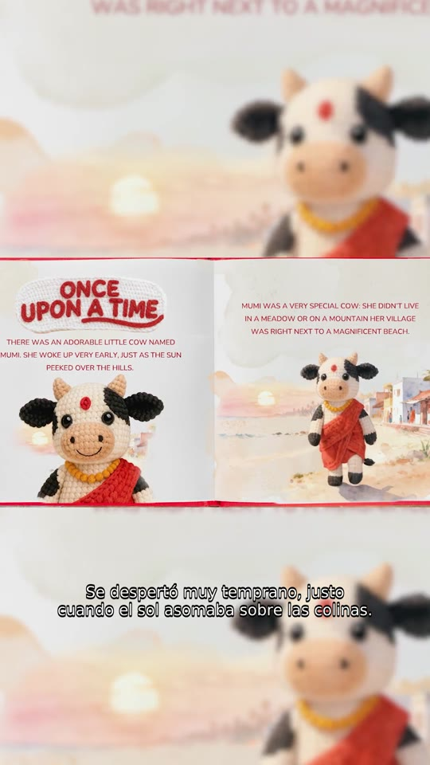

# Claude subtitula cualquier video

Claude no puede escuchar audio, pero tiene un entorno de ejecución de código en la nube. Este
prompt lo usa como un subtitulador profesional: instala Whisper (el modelo abierto de
reconocimiento de voz) en ese entorno, transcribe el inglés en el procesador, arma los
subtítulos, los traduce él mismo al español con reglas de subtitulado de televisión, los valida
con un script y, si se lo pedís, los quema en el video. No usa tu placa de video ni hace falta
instalar nada en tu computadora.

## Cómo se usa

1. Abrí una conversación nueva en [claude.ai](https://claude.ai) y adjuntá el video en inglés.
2. Copiá el prompt de [prompt.md](prompt.md) y completá el bloque **DATOS**: el video, los
   nombres propios que aparecen (ayudan a Whisper a escribirlos bien), la variante de español y
   si querés los subtítulos quemados.
3. Enviá. Claude te devuelve el `_ES.srt`, el `_EN.srt` de referencia, el video subtitulado si
   lo pediste y un reporte con lo que conviene que revise una persona.

## La prueba

Lo probamos el 15/10/2026 con nuestro plan Team de Claude (Sonnet 5.5), sobre un cuento de 30 s
en inglés de The Amigurumis, nuestra serie infantil, vertical 1080x1920. En
DATOS pusimos los nombres "Mumi, The Amigurumis", español neutro latinoamericano y subtítulos
quemados.

Del reporte que devolvió Claude:

| Paso | Tiempo |
|---|---|
| Instalación de faster-whisper | 8 s |
| Carga del modelo `small.en` | 5,0 s |
| Transcripción | 5,8 s |
| Quemado de subtítulos | 23,2 s |
| Armado y validación de los SRT | menos de 1 s |

- 7 subtítulos, sin errores de formato ni solapamientos, ninguna línea de más de 42 caracteres
  y ninguno por encima de 17 caracteres por segundo (el más alto, 15,7).
- Del envío a los archivos listos tardó unos tres minutos.
- Lo que marcó para revisar: Whisper escribió "peaked" donde la narración dice "peeked", y
  Claude lo corrigió leyendo el texto del libro que aparece en pantalla. El título de la obra lo
  dejó en inglés porque no estaba seguro del título oficial en español, y avisó.

Los subtítulos que devolvió están en [ejemplo/](ejemplo/).

## Cosas a tener en cuenta

- Es inglés a español. Para otro par de idiomas hay que cambiar el modelo de Whisper (`small.en`
  solo transcribe inglés) y las reglas de traducción.
- En videos largos el prompt le pide transcribir por tramos si el entorno corta procesos largos.
- Si la red del entorno bloquea un dominio (por ejemplo el de Hugging Face, de donde baja el
  modelo), Claude frena y te dice cuál es, para pedírselo a quien administre la cuenta.
- Revisá siempre los nombres propios y lo que el reporte marca como dudoso: el prompt le prohíbe
  inventar, pero la última palabra la tiene una persona.

---

Hecho por [NoMa Studio AI](https://nomastudio.ai), partner y afiliado de Claude y de ComfyUI en
LATAM. Si vas a probar ComfyUI en la nube, entrá por [nuestro link](https://www.comfy.org/?via=nomastudioai).
