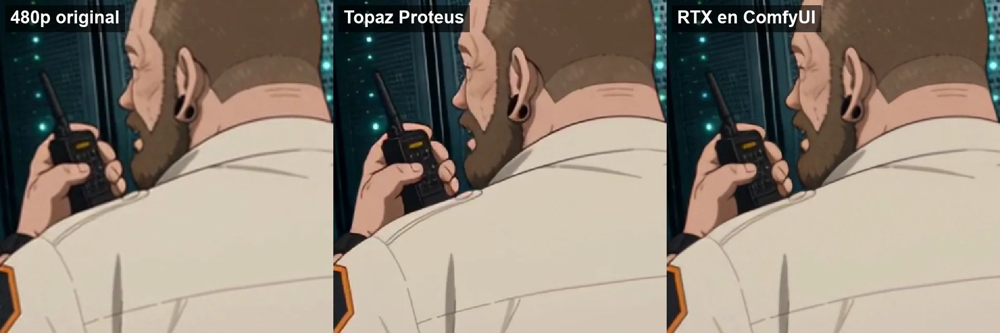

# Nodos VFX de NVIDIA RTX contra Topaz

El 13/10/2026 ComfyUI sumó los nodos VFX de NVIDIA RTX: super resolución, generación de
cuadros intermedios y conversión de SDR a HDR. En NoMa Studio AI generamos todo a 480p y
lo subimos de resolución al final con Topaz, así que la pregunta era obvia: ¿los nodos
RTX nos sirven para ese último paso?

## Qué probamos

Un plano de 7 s de nuestra serie de anime NN, generado con Seedance 2.5 a 854x480 y 24
fps, por tres caminos:

1. **Original 480p**, escalado bicúbico solo para poder compararlo.
2. **Topaz Proteus** a 1920x1080, que es lo que usamos hoy en producción.
3. **RTX Video Super Resolution** a 1920x1080 en calidad ULTRA, corriendo en Comfy Cloud.

Además pasamos la salida RTX por **RTX Video Frame Generation** x2 (de 24 a 48 fps)
para ver cómo queda en cámara lenta.

## Qué salió

- **Nitidez de línea:** en este plano de anime, Topaz Proteus deja las líneas y los
  detalles chicos (los botones del handy, el contorno de la oreja) más definidos. RTX
  queda más limpio que el original pero más suave que Topaz.
- **Costo:** los nodos RTX no son nodos de API pagos: en Comfy Cloud no consumen
  créditos de partner, solo tiempo de GPU. Topaz va por su propia cuenta y créditos.
- **Frame Generation:** a 48 fps el movimiento en cámara lenta queda más fluido que el
  original a 24.
- **Veredicto para nuestro pipeline:** para el master final seguimos con Topaz. RTX nos
  sirve para previews rápidos dentro del mismo workflow y para cámara lenta.

Es una sola prueba sobre un solo plano de anime. En material fotorrealista el resultado
puede cambiar.

## Cómo usarlo

`workflow.json` está en formato API de ComfyUI. Cambiá el archivo del nodo "Tu clip a
480p" por tu video. Si tu clip no es de 24 fps, ajustá el fps del nodo de 48 fps al
doble del tuyo. Los nodos RTX corren en Comfy Cloud o en una placa NVIDIA RTX local.

---

Hecho por [NoMa Studio AI](https://nomastudio.ai). Somos afiliados de ComfyUI: si lo
vas a probar en la nube, entrá por [nuestro link](https://www.comfy.org/?via=nomastudioai).
