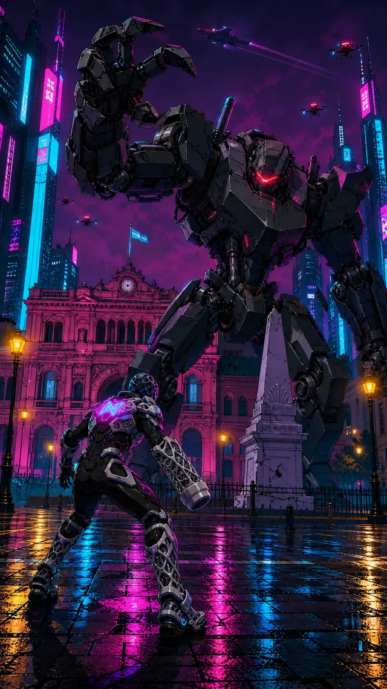

# 2D cel anime keyframe, Cyberpunk: Edgerunners / Studio Trigger style, bold linework, saturated neon palette.



```text
2D cel anime keyframe, Cyberpunk: Edgerunners / Studio Trigger style, bold linework, saturated neon palette. Image 1 is the master style reference: palette, lighting and linework. Image 2 is the character sheet: use the COMBATE mode variant (third from left), matte black plated suit with glowing magenta chest emblem, silver lattice armor plates on gauntlet and boots, exactly as designed in the sheet.

Compose a new vertical keyframe: the suited character in a low combat stance on the wet cobblestones of Plaza de Mayo, Buenos Aires 2077, seen from a low angle slightly behind him, facing a colossal hostile combat mecha about twenty meters tall: angular gunmetal armor, glowing red optical visor, exposed hydraulic pistons, one massive clawed arm raised mid-strike. The mecha towers over the plaza; behind it the historic pink palace facade is retrofitted with neon-edged megastructure towers, and the white colonial pyramid monument stands cracked between them. Magenta haze night sky with patrol drones and a high aircraft with light trails. Wet ground reflections in cyan and magenta, amber street lamps. The suited character occupies the lower third, small but defiant; the mecha fills the upper frame. Exactly one suited character and exactly one mecha. 2D cel animation, clean cel shading.
```
