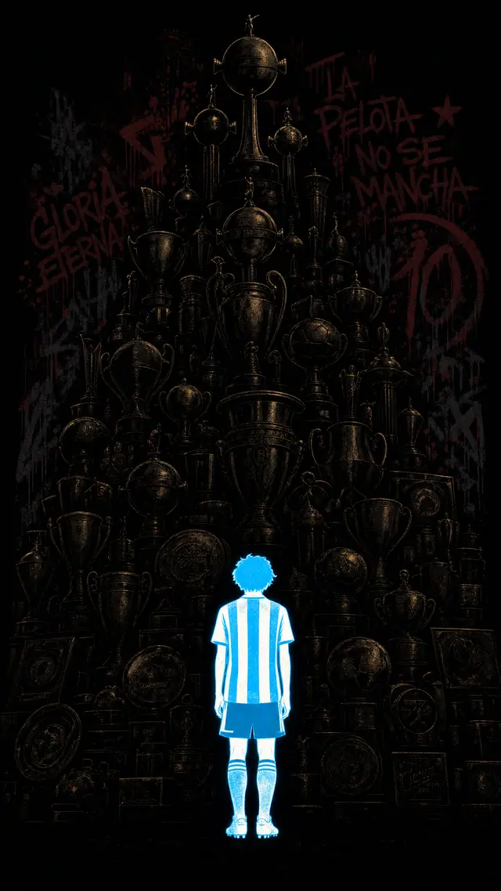

# Debut silhouette with trophy cathedral behind for hold-to-reveal



```text
Bold graphic sports-poster illustration, screen-print and street-art style, heavy ink linework, halftone and spray texture, high contrast, flat graphic shapes.

Vertical 9:16 composition. The background is pure solid black.

FOREGROUND, the only bright element in the image: the full body silhouette of a young slight teenage footballer standing completely alone, seen from behind, feet together, arms hanging at his sides, head slightly lowered, wearing a plain sky blue and white vertically striped jersey with dark shorts and socks. He is rendered as a flat glowing silhouette filled with luminous saturated sky blue and clean white stripes, hard clean edges, glowing as if lit from within, like a cut paper shape backlit. No facial features at all, no portrait, pure silhouette shape. He sits low and centred in the frame and is deliberately small, dwarfed by what rises behind him.

BEHIND HIM, all sunk in deep shadow: a towering cathedral of football trophies, dozens of cups stacked and receding upward into darkness, tall fluted trophies, wide round based cups, one large globe topped trophy near the top, shields and plates, piled all the way to the top edge of the frame like a monument. They are rendered in very dark bronze and deep desaturated gold, sitting at the very bottom of the value range, lit only by one dim warm rim light that catches a few edges and rims. They must read as a mass of barely emerging shapes, never bright, never gleaming.

Behind the trophies, a rough dark concrete wall covered in spray paint graffiti in deep red and dark grey, with drips and overspray, all of it in shadow.

CRITICAL lighting doctrine: ONLY the glowing sky blue and white silhouette carries bright values. The trophies, the wall and the graffiti all sit in near total shadow at the bottom of the value range. Crushed blacks, extreme contrast, no fill light whatsoever. The effect is one small glowing figure alone in a black void, with an enormous dark shape looming behind him that the eye can only just make out.

Bold graphic poster illustration, flat vector shapes with print texture, no photographic realism, no photograph.
```
