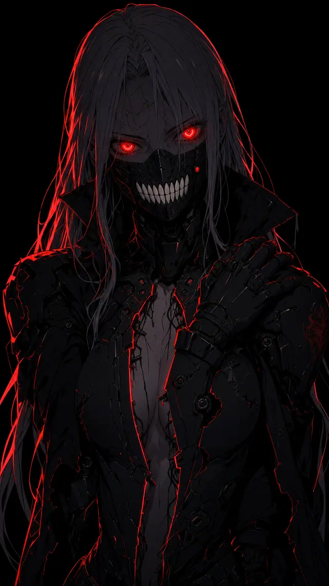

# Silent Death frontal close deep V plating hand on shoulder



```text
Anime cel shading, Studio Trigger key visual, crisp confident lineart, hard-edged cel shadows, flat graphic color, richly detailed character illustration.

Vertical 9:16 close medium shot, framed from mid torso up, of a lethal female cyber-mercenary in total darkness. Extreme low-key: background pure solid black, empty, no environment, no city, no sky, no fire, no haze.

Pose: facing the camera straight on, squared to the lens, chin lowered, head tilted very slightly. One arm crosses up over the torso so her gloved hand rests on her own opposite shoulder, fingers curled over the armor plate. Shoulders rolled back, spine gently arched. Slight low camera angle. Predatory calm, absolute stillness, the poise of someone who has never lost.

Eyes are the focal point: both eyes glow intense saturated red, large and dominant in the frame, bright ringed iris with a sharp specular core and a faint bloom halo, the single brightest element in the entire image. The gaze is locked dead into the lens.

Face: pale porcelain surface with a fine web of dark hairline cracks like glazed ceramic, most of it sunk in deep shadow. Lower face covered by a matte black armored respirator mask bearing a wide row of blunt interlocking bone-white teeth, crisply drawn and luminous against the black, with fine panel seams and vent slots and a small circular red indicator lamp on its side.

Hair: long straight pure white hair falling past the shoulders and framing the face. Its luminance is held low, reading as deep cool pewter gray, with only a handful of strands catching the red rim light as thin bright filaments. Never a bright white mass.

Armor design: matte black segmented plating, battle damaged. The torso plating is built as two swept panels that open in a deep narrow V running far down the front, the panels curving away to either side of a long central gap. Edges torn and hanging on their mounts, severed cabling and thin red glowing seams running through the fractures like cooling filaments. Dense mechanical micro detail: recessed panel lines, hex fasteners, chipped edges, layered plate overlaps. Frayed black coat collar rising tall behind the shoulders.

CRITICAL lighting doctrine: every surface in the frame sits at the very bottom of the value range, sunk in near-total shadow, never a bright pale mass. A single dim red rim light rakes her from behind and to the left, tracing her outline and the inner edges of the open plating as one continuous glowing red contour, falling to pure black within centimeters. No fill light whatsoever. Crushed blacks, extreme contrast. Only the red eyes and the white teeth of the mask carry bright values; everything else is drawn by a red edge in the dark.

Anime cel shading, 2D anime illustration, intricate linework, no photographic realism, no live action.
```
